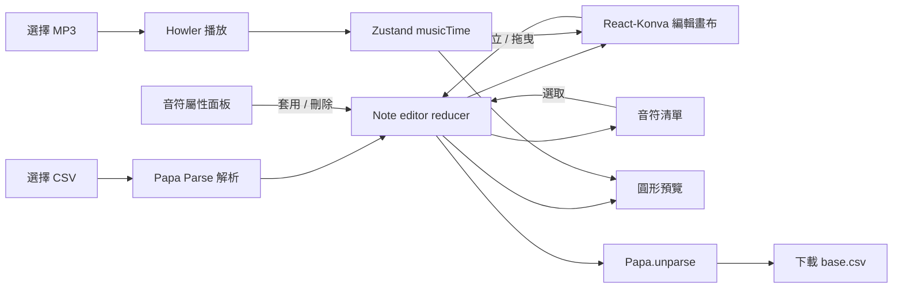

# Note Editor 程式導讀

這份文件依照目前 `src/` 的實作整理，重點放在時間軸編輯器如何建立、選取、移動、修改與刪除譜面事件，以及資料如何匯入 CSV、暫存在瀏覽器記憶體並下載匯出。

## 1. 專案啟動與結構

在 `Note_Editor/` 目錄執行：

```bash
npm install
npm run dev
```

其他常用命令：

```bash
npm run lint
npm run build
npm run preview
```

目前 `package.json` 沒有 test script。主要技術：React 管理 UI 和狀態、React-Konva 繪製可互動時間軸、Ant Design 提供輸入元件、Papa Parse 處理 CSV、Howler 播放音訊、Zustand 分享音樂時間。

| 檔案 | 職責 |
| --- | --- |
| `src/App.jsx` | 頁面組裝、設定 state、CSV 下載 |
| `src/pages/noteEditorState.jsx` | 音符 reducer、選取狀態、建立／更新／刪除操作與共用 context |
| `src/pages/noteEditorModel.js` | 音符資料轉換、時間吸附、時間軸計算與拖曳邊界 |
| `src/pages/editorCanvas.jsx` | 時間尺、譜面畫布、note／drag／rotate 互動、播放指示線 |
| `src/pages/noteEditor.jsx` | 音符清單與選取音符的屬性表單；透過共用 context 操作譜面 |
| `src/pages/control.jsx` | CSV 解析、音樂檔播放控制、音訊時間同步 |
| `src/pages/timmingAndNoteEditor.jsx` | 播放、時間滑桿、音符類型、拍號及縮放控制 |
| `src/pages/baseEditor.jsx` | CSV／MP3 檔案選擇、BPM／offset／軌道設定、預覽速度 |
| `src/pages/circlePreview.jsx` | 32 軌道圓形預覽與事件音效 |
| `src/store.js` | Zustand 的音樂時間、長度與 seek 函式 |
| `src/hook.jsx` | 共用數字輸入與數值限制函式 |
| `src/pages/notesSetting.jsx` | 設定抽屜；目前內容仍是 placeholder |
| `src/main.jsx` | React root、Ant Design 主題與全域樣式入口 |
| `src/App.css`、`src/hook.css`、`src/index.css` | 頁面、元件和全域樣式 |

## 2. 資料流總覽



`noteEditorState.jsx` 的 reducer 是譜面資料與選取狀態的唯一擁有者。清單、屬性表單和畫布透過 context 直接讀取資料或呼叫操作，不再經過 `App` 多層轉傳 callback。匯入後，譜面是 React state 中的 JavaScript 物件；編輯不會寫回原始 CSV。按 Download 才會把目前 state 序列化成新的下載檔。

## 3. 譜面資料模型

CSV 事件解析後主要有三種物件：

```js
{ type: 'note', time: 8758, land: 27 }
{ type: 'drag', timeStart: 2013, timeEnd: 4239, landStart: 15, landEnd: 30, direction: 1 }
{ type: 'rotate', time: 4430, direction: 1 }
```

匯入後還會加上預覽／遊戲相關欄位，例如 `startPosition`、`endPosition`、`lifePosition`、`notePosition`、`isActive`，drag 另有 `segment`。這些執行期欄位不是 `base.csv` 的輸出欄位。

`notes` 是 reducer 保存的內部資料；圓形預覽直接讀取這份資料，畫布則用 `noteEditorModel.js` 的轉換函式換算畫面座標。匯入時事件時間會加上 `chartOffset`，匯出時再扣回 offset。畫布拖曳完成後會先依節拍吸附，再把毫秒時間寫回 reducer；屬性表單則保留直接輸入的時間值。

常見欄位：

| 欄位 | 意義 |
| --- | --- |
| `type` | `note`、`drag` 或 `rotate` |
| `time` | note／rotate 觸發時間，毫秒 |
| `timeStart`、`timeEnd` | drag 起訖時間，毫秒 |
| `land` | note 軌道索引 |
| `landStart`、`landEnd` | drag 起訖軌道 |
| `direction` | drag／rotate 方向數值；依事件類型解讀 |

時間以毫秒儲存。編輯畫布軌道使用 1–31 的範圍，但圓形預覽按 0–31 顯示 32 個位置；外部譜面若有 `land=0`，需注意編輯畫布的拖曳限制目前會把值限制在 1–31。

## 4. Editor 編輯功能

畫布呈現在 [`src/pages/editorCanvas.jsx`](src/pages/editorCanvas.jsx)，狀態操作集中在 [`src/pages/noteEditorState.jsx`](src/pages/noteEditorState.jsx)，時間與座標規則集中在 [`src/pages/noteEditorModel.js`](src/pages/noteEditorModel.js)。畫布由三個主要區塊組成：

1. `TimeRuler`：顯示每小節毫秒位置，點擊標籤可 seek 到該時間。
2. `ChartTrack`：主要音符畫布，包含水平軌道、拍線、小節線、note 和 drag。
3. `RotateTrack`：獨立的 rotate 軌道，rotate 事件只沿時間軸移動。

### 時間與像素換算

`Editor` 以音樂長度和 `timmingControlValue` 計算畫布寬度：

```text
allWidth = duration(ms) / 1000 * pixelsPerSecond
x = time(ms) / 1000 * pixelsPerSecond
time = x / allWidth * duration
```

`xToTime` 會依 `noteEditorModel.js` 的節拍長度吸附時間。節拍長度為：

```text
divisionDuration = (60000 / BPM) * (4 / beat)
```

小節長度則是：

```text
barDuration = (60000 / BPM) * signature * (4 / beat)
```

`beat` 在這裡代表節拍的分母設定，`signature` 是每小節拍數。修改 BPM、beat、signature 會改變格線或吸附間隔，不會自動重寫全部既有音符時間。

### 軌道與 y 座標

畫布高度固定為 550px，軌道高度為 `550 / 31`。資料軌道轉畫面 y 的公式是：

```text
y = (land - 0.5) * laneHeight
land = round(y / laneHeight + 0.5)
```

畫布點擊或拖曳後都會把軌道限制在 1–31。`clampNumber` 和 `clampInteger` 集中處理數值邊界。

### 建立音符

`ChartTrack` 的 Stage 只有在點到空白畫布本身時才會建立事件；點到既有圖形不會觸發建立。建立流程如下：

1. 使用者在工具列選 `note`、`drag` 或 `rotate`。
2. 點畫布空白處，Stage 取得 pointer 的 x/y。
3. x 轉成時間並依 beat 吸附；y 轉成 1–31 的 land。
4. 畫布直接呼叫 context 的 `createNote` 操作。
5. reducer 將新物件附加到 `notes`，並在同一個狀態更新中選取新事件。

note 使用 `time` 和 `land`。drag 新建時會以目前時間開始、預設持續一個節拍，起訖 land 相同，direction 預設為 `0`。rotate 使用 `time`，direction 預設為 `0`。新事件還會加入執行期欄位，但匯出時會只取 CSV schema 欄位。

### 選取與移動

- note：點擊選取；拖曳圓點後，在拖曳結束時更新 `time` 和 `land`。
- drag：點擊箭頭選取；選取後顯示起點和終點控制點，可分別拖曳以修改時間和 land。箭頭本身目前不是可整體拖曳的物件。
- rotate：在下方 RotateTrack 點擊選取；拖曳只能改變時間，y 位置固定。
- 清單：點選音符列也能選取事件。列表按時間排序，但保留原本陣列 index 傳回 `App`，所以畫面排序不會直接改變資料順序。

Konva 的 `dragBoundFunc` 從時間軸模型取得拖曳範圍，`onDragEnd` 直接呼叫 context 的 `updateNote`。因此使用者拖曳期間主要是畫面暫時移動，放開後才將最後值提交至 reducer。

### 屬性面板、套用與刪除

`InputeNoteValues` 會依選取事件類型顯示不同欄位。欄位值先存在面板自己的 `fieldValues` state；按套用後，context 將整筆欄位更新送入 reducer。手動輸入值不會額外吸附；匯出時才扣回 offset。

刪除有兩個入口：面板的刪除按鈕，或選取事件後按鍵盤 Delete。鍵盤處理會避開 input、textarea、select 和 contenteditable，避免編輯欄位時誤刪音符。

`NotesList` 顯示的是排序後的資料；選取狀態以 `selectedIndex` 對應 reducer 中原始 `notes` 陣列。reducer 會在刪除事件後同步調整選取索引。若未來加入 undo/redo、多選或協作，建議為每個事件加入穩定 `id`，避免用陣列 index 作為長期識別。

## 5. CSV 匯入、記憶體編輯與匯出

### 匯入格式

[`src/pages/control.jsx`](src/pages/control.jsx) 使用 Papa Parse 解析 CSV，`header: false`、`dynamicTyping: true`、`skipEmptyLines: true`。目前格式前兩列是 metadata，第三列起是事件：

```csv
1200
15
note,2013,27
drag,2013,4239,15,30,1
rotate,4430,1
```

- 第 1 列第 1 欄：`chartOffset`。
- 第 2 列第 1 欄：`startLand`。
- note：`note,time,land`。
- drag：`drag,timeStart,timeEnd,landStart,landEnd,direction`。
- rotate：`rotate,time,direction`。

匯入時 `control.jsx` 會把事件時間加上 chartOffset 存進 state；顯示層再扣掉 offset。檔案本身只被讀取，不會被修改。

### 匯出格式

`App.jsx` 的 Download 按鈕用 Papa Parse `unparse` 序列化目前譜面，建立 Blob URL 並觸發瀏覽器下載，檔名為 `base.csv`。匯出時會：

- 輸出 offset 和 startLand 兩列 metadata。
- 依事件種類輸出對應欄位，不輸出 React／預覽用的執行期欄位。
- 將內部含 offset 的時間扣回 offset，得到 CSV 的時間值。
- 加入 UTF-8 BOM，改善部分試算表軟體開啟 UTF-8 CSV 時的亂碼問題。

下載的是新的檔案，不會覆寫使用者選取的來源檔。`csvData` 只存在目前頁面的記憶體中；重新整理頁面或關閉分頁後，尚未下載的編輯會消失。

## 6. 音樂播放與時間同步

`MusicChose` 將使用者選取的 MP3 建立成暫存 Object URL。`MusicController` 用 Howler 播放並在 `requestAnimationFrame` 中讀取播放秒數，換算成毫秒後更新 Zustand store。音樂載入完成後，duration 也會寫入 store；元件清除時會 unload Howl、撤銷 Object URL 並重設播放狀態。

`musicTimeZ` 儲存：

- `musicTime`：目前播放位置，毫秒。
- `musicDuration`：音樂長度，毫秒。
- `musicSeek`：由 Howler 提供的 seek callback。

頂部 Slider、毫秒輸入框、畫布播放指示線和圓形預覽都訂閱這份共用時間狀態。拖曳播放線時先顯示預覽位置，放開後才 seek 音樂。

## 7. 圓形預覽

[`src/pages/circlePreview.jsx`](src/pages/circlePreview.jsx) 以 SVG 繪製 32 條軌道和 0–31 編號。note／drag 事件會沿半徑由外向內移動，drag 會插值成 11 個預覽點；rotate 以整圈圓環表示。預覽速度由 `NoteSpeedControl` 控制，並使用 Howler 播放 hit 音效。

`useMemo` 會根據 `notes` 整理預覽事件，`useEffect` 監看音樂時間跨過事件觸發點時播放音效。這種方式適合此規模的預覽；若未來有大量事件，應測量效能，再考慮事件索引或虛擬化。

## 8. 其他設定與目前狀況

- BPM、beat、signature：影響格線、小節寬度與新增／拖曳時間的吸附；表單手動輸入保留指定值。
- offset：作為 CSV 時間與播放時間之間的轉換量。
- startLand：目前出現在設定欄位與 CSV metadata；並未傳入 `Editor` 參與畫布座標計算。
- `timmingControlValue`：同時影響每秒像素量與整個時間軸寬度。
- `speed`：只控制圓形預覽音符接近中心的速度。
- 設定 Drawer：目前顯示 `Some contents...`，尚未連結真正設定功能。
- `control.jsx` 的 CSV parser 目前假設前兩列 metadata 存在；若支援空檔案或格式錯誤檔案，應先做欄位數、事件種類、數字範圍及 Papa Parse errors 驗證，再更新 state。

## 9. 值得優先改善的工程設計

1. **抽離純資料函式**：時間軸換算、beat snapping、land clamp 和音符資料更新已集中在 `noteEditorModel.js`；CSV parse/unparse 仍在各自的檔案處理入口。
2. **穩定事件識別**：以 `id` 取代 `selectedIndex` 作為選取識別；陣列插入／刪除、排序或 undo 後會更可靠。
3. **統一方向語意**：方向顏色映射已集中在 `noteEditorModel.js`；未來若方向值增加，再把數值定義一併抽成常數。
4. **加入測試**：優先測 CSV round-trip、offset 加減、beat snapping、land 邊界、direction 和 drag 插值。UI 互動再用 React Testing Library 或 Playwright 驗證。
5. **補上 undo/redo**：譜面資料集中在 reducer，適合建立 past/present/future 歷史堆疊；每次完成一次語意操作（拖曳結束或按套用）存一個 history entry。
6. **整理檔案匯入錯誤 UI**：譜面 reducer、編輯器模型與畫面組裝已分離；可再讓 CSV parser 回傳明確錯誤，供頁面顯示原因。
7. **明確資料驗證與錯誤 UI**：匯入錯誤應顯示原因，不要只 `console.error`；驗證通過後再一次性提交資料，避免半套狀態。

## 10. 推薦學習順序與資源

### 建議順序

1. JavaScript 陣列與物件：`map`、`filter`、展開運算子、`Object.fromEntries`、不可變更新。
2. React：props、state、受控輸入、事件處理、`useEffect` 清除流程。
3. 座標與時間轉換：單位換算、比例尺、clamp、snap、線性插值。
4. React-Konva：Stage／Layer／Shape、事件 bubbling、drag bounds、畫布座標。
5. CSV 與瀏覽器檔案 API：Papa Parse、Blob、Object URL、File API。
6. 測試與型別：Vitest、React Testing Library、TypeScript，再逐步測資料轉換與互動。

### 文件與書籍

- [React 官方 Learn](https://react.dev/learn)：從 state、事件和 Effect 開始，對應 `App` 與各子元件的資料流。
- [React-Konva 文件](https://konvajs.org/docs/)：查 Stage、Layer、事件和拖曳行為。
- [Papa Parse 文件](https://www.papaparse.com/docs)：了解 parse/unparse、欄位錯誤和 CSV quoting。
- [Zustand 文件](https://zustand.docs.pmnd.rs/)：理解共用音樂時鐘 store。
- [MDN File API](https://developer.mozilla.org/en-US/docs/Web/API/File)、[Blob](https://developer.mozilla.org/en-US/docs/Web/API/Blob)、[URL.createObjectURL](https://developer.mozilla.org/en-US/docs/Web/API/URL/createObjectURL)：理解檔案讀取與瀏覽器下載流程。
- [Eloquent JavaScript](https://eloquentjavascript.net/)（Marijn Haverbeke）：適合補 JavaScript 基礎、資料結構與函式思考；有線上版本。
- *Learning React*（Alex Banks、Eve Porcello）：以 React 元件、state 和 Effect 為主，適合搭配本專案閱讀。
- *The Pragmatic Programmer*（David Thomas、Andrew Hunt）：適合進一步學習如何拆解需求、設計可維護程式和建立反饋迴圈。

## 11. 進入程式碼的建議路徑

想追一個新 note 如何出現，可依序閱讀：

1. `src/pages/timmingAndNoteEditor.jsx` 的 note type 選擇。
2. `src/pages/editorCanvas.jsx` 的 Stage `onClick` 和 `createNote` context 操作。
3. `src/pages/noteEditorState.jsx` 的 `createNote` 操作和 reducer。
4. `src/pages/editorCanvas.jsx` 的 `ChartEvents` 如何把資料轉成 Konva 圖形。
5. `src/pages/noteEditor.jsx` 如何選取、套用屬性及刪除。
6. `src/pages/control.jsx` 和 `App.jsx` 如何把 state 轉回 CSV。

想追播放時間，從 `src/pages/baseEditor.jsx` 的 MP3 input 開始，接著讀 `MusicChose`、`MusicController`、`src/store.js`，最後看 `Playhead` 和 `CirclePreview` 如何訂閱時間。
